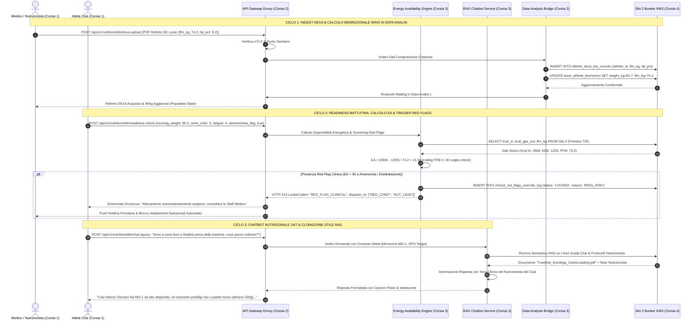

# Capitolato Tecnico: Flow NUT-3C – Nutrizione Dinamica, EA/REDs, DEXA, Red Flags & RAG Bunker (Tier 3 Elite Club)

## 1. Identificativo & Titolo Ufficiale
- **Badge Miro Board:** `#25` (Shape ID: `3458764691143273855`, Posizione LIVE: `X: 14500, Y: 8230`, Nodi ISO: `16`)
- **Codice Univoco:** `FLOW-NUT-3C`
- **Titolo Formale:** COLONNA 7: DIARIO NUTRIZIONE E STILE DI VITA - FLOW NUT-3C: TIER 3 (ELITE CLUB) - NUTRIZIONE DINAMICA, DISPONIBILITA ENERGETICA EA/REDS, DEXA, RED FLAGS & RAG BUNKER
- **Board Miro Online:** `uXjVEbo6L2o=` (Zona 4: Colonna 7, Riga 3 - Tier 3 Elite Club & KMS Enterprise)
- **Diagramma Sorgente:** [flow-nut-3c-elite-nutrition.mmd](../02-miro-zones-and-swimlanes/18-flowcharts/software-3-elite-club-enterprise/flow-nut-3c-elite-nutrition.mmd)
- **Riferimento Glossario:** [Glossario Tecnico Vivente](00-GLOSSARIO-TERMINI-TECNICI.md) (Voci: [Energy Availability EA & Sindrome REDs](00-GLOSSARIO-TERMINI-TECNICI.md#energy-availability-ea-e-sindrome-reds), [DEXA Dual-Energy X-ray Absorptiometry](00-GLOSSARIO-TERMINI-TECNICI.md#dexa-dual-energy-x-ray-absorptiometry), [Periodizzazione Nutrizionale Dinamica](00-GLOSSARIO-TERMINI-TECNICI.md#periodizzazione-nutrizionale-dinamica), [Red Flags Cliniche Human-in-the-Loop](00-GLOSSARIO-TERMINI-TECNICI.md#red-flags-cliniche-human-in-the-loop), [Certificazione Antidoping per Lotto Batch](00-GLOSSARIO-TERMINI-TECNICI.md#certificazione-antidoping-per-lotto-batch), [Potenza Relativa Watt su kg](00-GLOSSARIO-TERMINI-TECNICI.md#potenza-relativa-watt-su-kg-w-kg), [Chatbot Nutrizionale RAG 24/7](00-GLOSSARIO-TERMINI-TECNICI.md#chatbot-nutrizionale-rag-247), [Cloud KMS Enclave Silo 2](00-GLOSSARIO-TERMINI-TECNICI.md#cloud-kms-key-management-service)).
- **Nota di Governance & Separazione Database:** Il modulo risiede interamente sulla partizione **Silo 2 (Encrypted Club Bunkers - Tier 3)** con cifratura di grado militare a chiavi gestite (Google Cloud KMS - AES-256-GCM) per ciascuna franchigia sportiva o club di Serie A/Eurolega. I dati ematochimici e nutrizionali sono segregati sotto rigoroso Segreto Medico (Row-Level Security & Role-Based Access Control) e non possono confluire nel Silo 1 sociale né nel Silo 3 della ricerca senza formale autorizzazione del comitato etico e opt-in della società sportiva.

---

## 2. Obiettivo di Business & Target Utente

### Guida Pratica per Non Tecnici: Cos'e questo modulo per un umano?
Nei club sportivi professionistici di alto livello (calcio di Serie A, basket di Eurolega, sport olimpici), la nutrizione non è una semplice dieta, ma una leva strategica per massimizzare la prestazione, accelerare il recupero e prevenire infortuni gravi: se un atleta consuma 4000 calorie in campo ma ne assume solo 2500 per giorni consecutivi, il corpo collassa in un deficit cronico (sindrome REDs - Relative Energy Deficiency in Sport) che porta a fratture da stress, calo del testosterone o amenorrea, alterazioni tiroidee e crollo immunitario.  
**Nutrizione Dinamica & Prestazione Elite (Tier 3 Elite Club)** è il centro di comando nutrizionale e medico integrato che connette l'intero ecosistema della società sportiva:
- **Connessione Totale dell'Ecosistema (All-in-One):** la nutrizione comunica in tempo reale e in modo bidirezionale con la Programmazione dei microcicli (#15), con la Data Analisi GPS (#16), con la sezione Readiness (#15) e con il Dossier Salute dell'atleta;
- **Sincronizzazione Bidirezionale della Composizione Corporea:**
  - *Da Nutrizione a Data Analisi:* non appena il nutrizionista registra una variazione di peso, massa grassa o massa magra, la piattaforma ricalcola istantaneamente tutti i parametri di potenza relativa (Watt/kg) e i rapporti peso/forza nei test sui salti e negli sprint;
  - *Da Data Analisi a Nutrizione:* i referti di esami specialistici (DEXA ossea/corporea o BIA multifrequenza caricati dallo staff medico in formato PDF o Excel) vengono acquisiti all'istante dal modulo nutrizione senza alcun bisogno di reinserirli a mano;
- **Monitoraggio Continuo dell'Energy Availability (EA) e Prevenzione REDs:** il server incrocia le calorie consumate (rilevate da qualsiasi dispositivo wearable o pettorina GPS sul mercato), le calorie assunte con i pasti e i chili di massa magra (FFM), calcolando ogni giorno la disponibilità energetica netta con un semaforo visivo (Verde: $> 45\text{ kcal/kg FFM}$, Giallo: $30-45$, Rosso: $< 30$);
- **Periodizzazione Nutrizionale Dinamica e Automatica:** i fabbisogni di carboidrati, proteine e grassi e le tempistiche di assunzione si adattano automaticamente ogni giorno in base ai carichi previsti dal preparatore (es. giorno partita MD, carico intenso MD-3, recupero attivo MD+1);
- **Integrazione Readiness e Blocchi di Sicurezza Clinica ("Red Flags" Human-in-the-Loop):** il sistema legge ogni mattina i dati di risveglio compilati dall'atleta (sonno, colore delle urine, stanchezza percepita, ciclo mestruale). In presenza di campanelli d'allarme clinici (calo ponderale rapido inspiegabile, amenorrea per le atlete, disidratazione acuta), l'algoritmo blocca all'istante gli adattamenti automatici e invia un alert prioritized a Medico Sociale e Nutrizionista;
- **Correlazione con Esami del Sangue e Biomarcatori:** l'intelligenza artificiale incrocia i referti ematici periodici con la cronologia dei carichi fisici, distinguendo tra carenze reali (es. ferro, ferritina, vitamina D) e temporanee alterazioni fisiologiche causate dallo sforzo acuto della gara;
- **Tutela Antidoping Certificata per Lotto:** ogni integratore somministrato viene controllato verificando il numero di lotto (Batch ID) sulle banche dati ufficiali antidoping internazionali (Informed Sport, Cologne List) per azzerare il rischio di squalifiche per contaminazione;
- **Chatbot Nutrizionale 24/7 con Clonazione dello Stile:** un assistente dedicato accessibile in qualsiasi momento sullo smartphone dell'atleta, addestrato tramite tecnologia RAG sul lessico, sulle ricette e sui protocolli personalizzati del nutrizionista del club, capace di guidare l'atleta nei pasti fuori casa o nelle trasferte internazionali.

### Specifiche di Business & Metriche
- **Target Utente:** Staff Medico Sociale, Responsabile Nutrizione, Head of Performance / S&C e Atleti Professionisti di Top Club.
- **Problema Risolto:** Sindrome da deficit energetico (REDs), disallineamento tra carichi atletici ed alimentazione, rischio doping da integratori contaminati e perdita di tempo in doppi inserimenti dati tra staff.
- **Stato Gap Analysis (Regola 10):** Arancione (`#e67e22` - Nuovo modulo Enterprise Colonna 7 su Silo 2 KMS).
- **Metriche Chiave (KPI):**
  - Tempo di calcolo Energy Availability per 30 atleti: $< 400\text{ ms}$;
  - Latenza trigger blocco Red Flag clinica e invio alert medico: $< 1.0\text{ s}$;
  - Tempo di sincronizzazione bidirezionale Nutrizione <-> Data Analisi: $< 200\text{ ms}$;
  - Copertura verifica antidoping per lotto: $100\%$ integratori somministrati;
  - Latenza risposta Chatbot RAG 24/7 su app atleta: $< 1.5\text{ s}$.

---

## 3. Attori & Architettura a 4 Corsie (Swimlanes)

1. **Corsia 1: Thin Client UI/UX (Enterprise Club Suite & Athlete Mobile App):**
   - Nutrition Command Center (Desktop Staff): cruscotto della rosa con semafori EA, trend di composizione corporea e calendario nutrizionale sincronizzato sul microciclo MD-X;
   - Clinical Ingest Station: upload drag & drop di referti DEXA (GE Lunar / Hologic) e BIA multifrequenza (PDF e fogli Excel grezzi);
   - Athlete Companion Chat: interfaccia conversazionale 24/7 per l'atleta con risposte istantanee su timing pasti, idratazione e pasti al ristorante;
   - Red Flags Safety Override Banner: pannello rosso ad alta visibilità che interdice modifiche automatiche in caso di parametri sanitari anomali.
2. **Corsia 2: API Gateway & Envoy Enterprise Security Enclave:**
   - Autenticazione mTLS 1.3 con certificati societari e token JWT con crittografia KMS (`role: MEDICAL_CHIEF`, `NUTRITION_LEAD`, `ATHLETE_ID`);
   - Intercettore Zero-Trust con controllo di conformità antidoping e validazione dello stato clinico;
   - Dispatcher di allerta per Red Flags: se il calcolo mattutino evidenzia anomalie sanitarie, genera HTTP 423 Locked e instradamento prioritario push/SMS/email verso il Medico Sociale.
3. **Corsia 3: Server Scatola Nera (Elite Nutrition & RAG Engines - Cloud Run Bunker):**
   - **Energy Availability & REDs Engine:** applicazione continua della formula SI:  
     $$\text{EA} = \frac{\text{Energy Intake (kcal)} - \text{Exercise Energy Expenditure (kcal)}}{\text{Fat-Free Mass (kg)}}$$  
     Monitoraggio su finestra mobile di 3 e 7 giorni;
   - **Dynamic Periodization Orchestrator:** ricezione carichi programmati (Colonna 3 #15) e telemetrie GPS (Colonna 4 #16) per modulare carboidrati ($3 - 10\text{ g/kg}$) e timing dei pasti;
   - **Blood Biomarker AI Engine:** analisi differenziale tra valori ematochimici e carichi acuti (es. CPK elevato, ferritina, transferrina, testosterone/cortisolo);
   - **Batch Antidoping Verification Service:** interrogazione via API REST dei registri Informed Sport e Kölner Liste con verifica del codice lotto di produzione stampato sulla confezione;
   - **RAG Style Cloner Service:** motore linguistico con RAG privato su partizione Silo 2 (documenti clinici interni, linee guida club, stile del nutrizionista) che serve risposte 24/7 senza token limitati.
4. **Corsia 4: Database Tripartito (Silo 2 - Bunker KMS Encrypted PostgreSQL):**
   - Tabelle protette: `athlete_clinical_nutrition_vault`, `athlete_energy_availability_timeseries`, `athlete_dexa_bia_records`, `antidoping_batch_registry`, `clinical_red_flags_override_log`;
   - Bridge Bidirezionale: integrazione a livello database con `athlete_performance_gps_metrics` (#16) e `team_microcycle_plans` (#15).

---

### Sequence Diagram Asincrono del Ciclo di Vita (FLOW-NUT-3C)



---

## 4. Flusso Passo-Passo

### Livello A: Guida Operativa & User Journey Narrativo
1. **Accesso al Cockpit Nutrizionale della Squadra:** Il nutrizionista e il medico sociale aprono la schermata di squadra. Ciascun atleta ha una scheda con l'indicatore a semaforo dell'Energy Availability (Verde, Giallo o Rosso), l'ultimo dato DEXA, il carico previsto per il giorno successivo e lo stato di idratazione.
2. **Caricamento del Referto DEXA e Aggiornamento dei Test:** Quando la squadra effettua le visite di controllo semestrali, lo staff carica direttamente i PDF dei referti DEXA. Il sistema estrae automaticamente massa magra e densità ossea, aggiornando all'istante i calcoli di potenza atletica (Watt per chilo) nella sezione Data Analisi senza dover ridigitare alcunché.
3. **Calcolo Quotidiano dell'Energy Availability (Prevenzione REDs):** Ogni giorno, dopo la seduta sul campo, la piattaforma raccoglie i dati GPS (dispendio in calorie) e i pasti registrati nella mensa societaria, calcolando la disponibilità energetica per chilo di massa magra. Se un calciatore mostra valori bassi per più giorni consecutivi, il nutrizionista riceve un suggerimento di integrazione mirata prima che insorgano lesioni muscolari.
4. **Attivazione del Blocco Red Flags (Human-in-the-Loop):** Al mattino gli atleti compilano in 30 secondi il test di prontezza (peso, colore delle urine secondo la scala di Armstrong, qualità del sonno). Se un'atleta registra una perdita involontaria di 2 kg in 48 ore associata ad alterazioni mestruali o urine scure, il sistema attiva immediatamente la "Red Flag": sospende ogni consiglio di dieta automatica e invia un avviso prioritario al medico sociale per una visita urgente.
5. **Periodizzazione Automatica sui Carichi di Gioco:** In assenza di anomalie cliniche, il sistema periodizza i nutrienti in base al giorno della settimana rispetto alla partita (MD - Match Day): ad esempio, a MD-1 (vigilia) aumenta automaticamente l'apporto di carboidrati complessi per saturare il glicogeno epatico e muscolare, mentre a MD+1 (giorno dopo gara) massimizza antiossidanti, liquidi e proteine per la riparazione dei tessuti.
6. **Verifica Antidoping Certificata sul Lotto:** Prima che un integratore venga somministrato all'atleta nello spogliatoio, il magazziniere o il nutrizionista scansiona il codice a barre o digita il numero di lotto (Batch ID). Il server contatta le banche dati di Informed Sport e Cologne List; solo se il lotto specifico risulta testato e certificato esente da contaminanti, il sistema ne autorizza la distribuzione.
7. **Assistente Nutrizionale 24/7:** Durante le trasferte internazionali o nel tempo libero, l'atleta può scrivere al chatbot dell'app: l'assistente, addestrato sullo stile e sulle prescrizioni del nutrizionista sociale, risponde con consigli precisi su cosa ordinare al ristorante o come gestire l'idratazione in aereo.

### Livello B: Deep-Dive Tecnico & Dettagli di Implementazione
1. **Modello Matematico Energy Availability (EA):**
   - Formula: $\text{EA} = \frac{\text{EI} - \text{EEE}}{\text{FFM}}$ (unità di misura: $\text{kcal}\cdot\text{kg FFM}^{-1}\cdot\text{day}^{-1}$);
   - Calcolo EEE (Exercise Energy Expenditure): calcolato integrando la spesa energetica metabolica della pettorina GPS durante la seduta (es. Catapult, StatSports, Wimu) decurtata del metabolismo basale durante la medesima durata;
   - Matrice di Rischio Clinico REDs:
     - $\text{EA} > 45\text{ kcal/kg FFM}$: Stato Ottimale (Semaforo Verde);
     - $30 \le \text{EA} \le 45\text{ kcal/kg FFM}$: Sub-clinico / Deficit Moderato (Semaforo Giallo, Alert Nutrizionista);
     - $\text{EA} < 30\text{ kcal/kg FFM}$: Deficit Severo Critico (Semaforo Rosso, Blocco Clinico Immediato).
2. **Bridge Bidirezionale Nutrizione <-> Data Analisi:**
   - Trigger di database PostgreSQL asincrono `trg_sync_athlete_ffm_to_power`:
     - All'inserimento di un nuovo record in `athlete_dexa_bia_records`, calcola $\text{Weight}_{\text{new}}$ e $\text{FFM}_{\text{new}}$;
     - Aggiorna la tabella `data_analysis_jump_tests` ricalcolando la forza relativa: $F_{\text{rel}} = \frac{F_{\text{peak}} (\text{N})}{\text{Weight (kg)}}$;
     - Aggiorna la tabella `data_analysis_sprint_vbt` ricalcolando la potenza specifica: $P_{\text{rel}} = \frac{P_{\text{mean}} (\text{W})}{\text{Weight (kg)}}$.
3. **Controllo Antidoping per Lotto (Batch Certification Engine):**
   - Connettore REST verso le API di LGC Informed Sport (`https://api.wetestyoutrust.com/v1/batches/{batch_id}`) e Cologne List;
   - La risposta restituisce timestamp del test analitico, laboratorio accreditato ISO 17025 e certificato di analisi PDF;
   - Se il lotto non è presente nel database, la somministrazione viene bloccata con codice `ANTIDOPING_BATCH_UNCERTIFIED`.
4. **Chatbot RAG 24/7 con Style Cloning (Silo 2 Bunker KMS):**
   - Vector Store PostgreSQL `pgvector` residente all'interno dell'enclave isolata del club;
   - Embeddings generati con modello di embedding specialistico biomedico a 768 dimensioni;
   - Algoritmo di Retrieval-Augmented Generation con System Prompt calibrato sulle direttive del Nutrizionista del club (temperatura 0.2 per zero allucinazioni cliniche).

---

## 5. Rami Decisionali & Gestione Errori (4 Stati UI)

### Albero Decisionale
```text
[Rilevazione Dati Quotidiani Atleta (Pasti, GPS, Readiness)]
  |
  +--> Calcolo Energy Availability (EA)
  |      |--> EA < 30 kcal/kg FFM o presenza Red Flag Clinica (Amenorrea, Calo > 3% in 48h, Disidratazione)?
  |      |      |--> SI: Blocco Immediato Adattamenti -> HTTP 423 -> Alert Medico/Nutrizionista (Error State)
  |      |      +--> NO: Parametri regolari -> Continuazione pipeline
  |
  +--> Periodizzazione Nutrizionale Dinamica (Microciclo MD-X)
  |      |--> Partita imminente (MD-1 o Giorno Gara)?
  |      |      |--> SI: Saturazione Carboidrati (6-8 g/kg) + Sodium Pre-Loading (Populated State)
  |      |      +--> NO: Giorno di recupero o scarico -> Focus Proteico & Anti-Infiammatorio (Populated State)
  |
  +--> Verifica Lotto Integratore (Batch ID)
  |      |--> Lotto certificato su database Informed Sport / Kölner Liste?
  |      |      |--> SI: Autorizzazione somministrazione con codice verde (Populated State)
  |      |      +--> NO: Certificazione assente -> Blocco tassativo per rischio doping (Error State)
  |
  +--> Chatbot RAG Atleta 24/7
         |--> Risposta coerente con le linee guida societarie del Silo 2?
                |--> SI: Consegna consiglio personalizzato con tono nutrizionista (Populated State)
                +--> NO: Query ambigua o medica -> Rimando diretto al colloquio con il Medico Sociale
```

### I 4 Stati dell'Interfaccia Utente (UI)
1. **Empty State:** Visualizzato in pre-stagione quando il club non ha ancora caricato referti DEXA o quando un nuovo acquisto entra nella rosa. Mostra l'avviso: "Dossier Nutrizionale Incompleto: caricare il referto DEXA/BIA iniziale e registrare la baseline ematochimica prima di attivare la periodizzazione dinamica".
2. **Loading State:** Cruscotto di calcolo telemetrico con barra di avanzamento e badge "Sincronizzazione GPS & Carichi Microciclo in corso...", che elabora contemporaneamente la spesa energetica di tutti i giocatori della rosa.
3. **Populated State:** Dashboard completa con semafori EA di squadra, grafico a violino della composizione corporea, indicatori di idratazione mattutina, menu periodizzati per il giorno successivo e stato dei lotti antidoping approvati.
4. **Error / Fallback State:** Se scatta un allarme Red Flag, l'interfaccia dell'atleta e dello staff sostituisce i controlli operativi con un pannello rosso lampeggiante con indicazione della causa medica, numero di emergenza dello staff sanitario e divieto di carico fino a sblocco manuale firmato digitalmente dal Medico Sociale.

---

## 6. Contratti Dati JSON & Matrice Errori HTTP

### Contratto Calcolo Energy Availability & Screening REDs (`POST /api/v1/nutrition/elite/energy-availability`)
```http
POST /api/v1/nutrition/elite/energy-availability
Authorization: Bearer <jwt_tier3_kms_token>
Content-Type: application/json
```
```json
{
  "athlete_id": "ath_seria_10",
  "assessment_date": "2026-11-21",
  "energy_intake_kcal": 3100,
  "exercise_energy_expenditure_gps_kcal": 1350,
  "readiness_flags": {
    "urine_color_scale_armstrong": 5,
    "rapid_weight_loss_48h_pct": 1.2,
    "menstrual_irregularity_flag": false,
    "morning_fatigue_score": 3
  }
}
```
```json
{
  "athlete_id": "ath_seria_10",
  "fat_free_mass_kg": 72.4,
  "computed_energy_availability_kcal_per_kg_ffm": 24.17,
  "red_s_clinical_status": "HIGH_RISK_DEFICIT",
  "status_color": "RED",
  "red_flag_triggered": true,
  "clinical_override_actions": {
    "block_automatic_periodization": true,
    "priority_medical_alert_dispatched": true,
    "recipients": ["medico.sociale@eliteclub.it", "nutrizionista@eliteclub.it"]
  },
  "suggested_clinical_interventions": [
    "Sospensione incremento carichi ad alta intensità",
    "Integrazione liquida immediata con carboidrati ad alto indice glicemico (80g)",
    "Controllo idroelettrolitico e profilo ematico urgente"
  ]
}
```

### Contratto Verifica Antidoping Lotto (`POST /api/v1/nutrition/elite/antidoping-check`)
```http
POST /api/v1/nutrition/elite/antidoping-check
Authorization: Bearer <jwt_tier3_kms_token>
Content-Type: application/json
```
```json
{
  "brand_name": "Optimum Elite Nutrition",
  "product_name": "Whey Isolate Hydro 1000g",
  "batch_number": "L_2026_9941A",
  "expiry_date": "2027-08-30"
}
```
```json
{
  "verification_status": "CERTIFIED_CLEAN",
  "authority": "INFORMED_SPORT_LGC",
  "certificate_id": "CERT_LGC_9941A_2026",
  "tested_substances_count": 285,
  "prohibited_wada_substances_detected": false,
  "dispense_allowed": true,
  "digital_signature_kms": "kms:rsa-sha256:d8a9f201bc894e"
}
```

### Schema Relazionale (Database Silo 2 Bunker KMS - PostgreSQL)

```sql
-- TABELLA DOSSIER CLINICO NUTRIZIONE ATLETA (SILO 2 BUNKER KMS)
CREATE TABLE athlete_clinical_nutrition_vault (
    record_id UUID PRIMARY KEY DEFAULT gen_random_uuid(),
    club_id UUID NOT NULL,
    athlete_id UUID NOT NULL,
    encrypted_dossier_blob BYTEA NOT NULL, -- AES-256-GCM encrypted via Cloud KMS
    current_ffm_kg NUMERIC(5, 2) NOT NULL,
    current_fat_pct NUMERIC(4, 2) NOT NULL,
    last_dexa_date DATE NOT NULL,
    red_flag_lock BOOLEAN NOT NULL DEFAULT FALSE,
    updated_at TIMESTAMPTZ NOT NULL DEFAULT NOW()
);
CREATE INDEX idx_athlete_nutrition_vault ON athlete_clinical_nutrition_vault (club_id, athlete_id);

-- TABELLA SERIE TEMPORALI ENERGY AVAILABILITY & REDs
CREATE TABLE athlete_energy_availability_timeseries (
    log_id UUID PRIMARY KEY DEFAULT gen_random_uuid(),
    athlete_id UUID NOT NULL,
    record_date DATE NOT NULL,
    energy_intake_kcal NUMERIC(6, 1) NOT NULL,
    exercise_energy_expenditure_kcal NUMERIC(6, 1) NOT NULL,
    computed_ea_ratio NUMERIC(5, 2) NOT NULL,
    risk_tier VARCHAR(16) NOT NULL CHECK (risk_tier IN ('OPTIMAL_GREEN', 'MODERATE_YELLOW', 'CRITICAL_RED')),
    red_flag_override_triggered BOOLEAN NOT NULL DEFAULT FALSE,
    created_at TIMESTAMPTZ NOT NULL DEFAULT NOW()
);
CREATE INDEX idx_athlete_ea_history ON athlete_energy_availability_timeseries (athlete_id, record_date DESC);

-- TABELLA REGISTRO ANTIDOPING CERTIFICAZIONE PER LOTTO
CREATE TABLE antidoping_batch_registry (
    batch_entry_id UUID PRIMARY KEY DEFAULT gen_random_uuid(),
    club_id UUID NOT NULL,
    product_name VARCHAR(128) NOT NULL,
    batch_code VARCHAR(64) NOT NULL,
    certifying_agency VARCHAR(64) NOT NULL CHECK (certifying_agency IN ('INFORMED_SPORT', 'COLOGNE_LIST', 'NSF_SPORT')),
    certificate_reference VARCHAR(128) NOT NULL,
    verification_passed BOOLEAN NOT NULL DEFAULT TRUE,
    certified_until DATE NOT NULL,
    verified_at TIMESTAMPTZ NOT NULL DEFAULT NOW()
);
CREATE UNIQUE INDEX idx_batch_unique_cert ON antidoping_batch_registry (batch_code, certifying_agency);

-- TABELLA LOG BLOCCHI DI SICUREZZA RED FLAGS
CREATE TABLE clinical_red_flags_override_log (
    override_id UUID PRIMARY KEY DEFAULT gen_random_uuid(),
    athlete_id UUID NOT NULL,
    triggered_by_event VARCHAR(64) NOT NULL,
    ea_value NUMERIC(5, 2) NOT NULL,
    biological_parameters JSONB NOT NULL,
    medical_notified_at TIMESTAMPTZ NOT NULL DEFAULT NOW(),
    resolved_by_physician_id UUID,
    resolution_notes TEXT,
    resolved_at TIMESTAMPTZ
);
```

### Matrice Errori HTTP a 6 Colonne

| Codice HTTP | Errore Interno | Condizione Scatenante | Risposta Client | Azione Automatica Client | Ripristino Utente |
| :--- | :--- | :--- | :--- | :--- | :--- |
| `400 Bad Request` | `DEXA_PDF_PARSING_FAILED` | File DEXA caricato privo di tracciati o corrotto | `{"error": "Impossibile estrarre i parametri di densitometria ossea o massa magra dal file"}` | Evidenzia il file caricato ed elenca i formati accettati | Caricare il referto originale GE Lunar/Hologic o foglio Excel |
| `401 Unauthorized` | `KMS_MTLS_HANDSHAKE_FAILED` | Mancanza di certificato mTLS valido del club o chiave KMS revocata | `{"error": "Accesso non autorizzato: certificato di sicurezza societario non valido"}` | Interrompe la sessione e disconnette l'utente | Contattare l'amministratore IT del club per il rinnovo certificato |
| `403 Forbidden` | `MEDICAL_ROLE_RESTRICTED` | Preparatore che tenta di disattivare manualmente un blocco Red Flag senza autorizzazione | `{"error": "La rimozione di un blocco clinico Red Flag è riservata al Medico Sociale"}` | Disabilita il pulsante di sblocco e notifica il Medico | Richiedere la revisione del caso al Medico Sociale del club |
| `404 Not Found` | `BATCH_NOT_FOUND_IN_REGISTRY` | Il numero di lotto dell'integratore non risulta nel database antidoping ufficiale | `{"error": "Numero di lotto non trovato nei registri Informed Sport o Kölner Liste"}` | Segnala il prodotto in rosso e vieta la somministrazione | Non somministrare il prodotto e contattare il fornitore |
| `409 Conflict` | `RED_FLAG_SAFETY_BLOCK` | Tentativo di aggiornare carichi nutrizionali automatici con atleta in allarme clinico | `{"error": "Adattamenti automatici bloccati: rilevato allarme clinico REDs per l'atleta"}` | Blocca la schermata e mostra il pannello medico prioritario | Attendere lo sblocco clinico da parte dello Staff Medico |
| `423 Locked` | `ATHLETE_DOSSIER_ENCRYPTED` | Tentativo di accesso concorrente o sessione KMS bloccata per auditing | `{"error": "Dossier nutrizionale temporaneamente protetto per controllo di sicurezza"}` | Mostra lo stato di sincronizzazione crittografica | Riprovare tra 30 secondi al termine del lock crittografico |
| `503 Service Unav` | `ANTIDOPING_API_TIMEOUT` | Servizi esterni Informed Sport / Cologne List momentaneamente non raggiungibili | `{"error": "Verifica antidoping remota momentaneamente non disponibile"}` | Imposta lo stato dell'integratore su 'In Attesa di Convalida' | Riprovare la scansione del lotto non appena il server risponde |

---

## 7. Ereditarieta di Tier & Sblocco Funzionalita a Cascata (Integrazione Ecosistema T7)

- **Posizionamento Architetturale di Tier 3:** Il modulo rappresenta il **livello Enterprise e Clinico di massimo prestigio**, dedicato a club professionistici, nazionali e centri di ricerca sportiva d'élite, protetto nella camera stagna **Silo 2 (Encrypted Club Bunkers KMS)**.
- **Eredità e Superamento dei Limiti di Tier 1 e Tier 2:**
  - Eredita tutte le strutture di tracciamento misure (Tier 1) e le metodologie di composizione corporea con taratura FFM-based (Tier 2);
  - **Sblocco Totale Wearable:** cade il vincolo monomarca dei soli dispositivi T7; in Tier 3 qualsiasi pettorina GPS societaria (Catapult, StatSports, Wimu) o smartwatch sul mercato viene sincronizzato automaticamente per il calcolo continuo del dispendio energetico reale;
  - **Sblocco AI al 100% senza limiti:** potenza di calcolo illimitata con modelli multimodali proprietari e RAG dedicato privo di quote token mensili;
  - **Interconnessione Completa dell'Ecosistema:** sincronizzazione automatica bidirezionale con la Programmazione microcicli MD-X (#15) e con la Data Analisi (#16) per l'aggiornamento real-time dei parametri di potenza relativa (Watt/kg);
  - **Dall'Isolamento all'Integrazione Clinica:** laddove Tier 1 e Tier 2 mantengono i silos disaccoppiati per ragioni di privacy, Tier 3 unifica i flussi sotto la responsabilità del Medico Sociale con meccanismo **Human-in-the-Loop**, bloccando qualsiasi automazione in presenza di Red Flags a tutela assoluta della salute dell'atleta;
  - **Tutela Antidoping Rigorosa per Singolo Lotto:** garanzia legale e sportiva contro squalifiche da contaminazione tramite controllo incrociato sui laboratori accreditati WADA.
