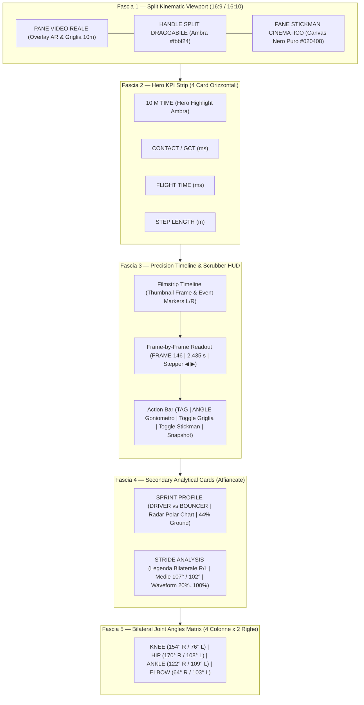

# Dossier Tecnico di Ricerca UI/UX: Video Biomeccanica & Gait Analysis
## Benchmark Kinepose & Dark Cockpit Design System per T7 Workout Platform

> **Documento di Specifiche UI/UX & Pattern Replicabili (Regola 09 & Skill `ui-ux-pattern-extractor`)**  
> **Target Architetturale:** Modulo Data Analisi (Video Biomeccanica, Goniometria & Gait) ed estensioni video del Catalogo Esercizi (Three.js 3D & Multi-Camera 4K).  
> **Benchmark di Riferimento:** Applicazione di Computer Vision & Sprint Analytics *Kinepose* (`media_1795861090047_ce847678.jpg`).  
> **Conformità Inviolabile:** Regola 01 (zero emoji spontanee, solo icone SVG lineari), Regola 02 (costanti in MAIUSCOLO), Regola 03 (nessun `undefined` o `NaN`), Regola 08 (separazione a 3 Tier), ADR-01 (Thin Client con calcoli protetti server-side) e ADR-03 (grandezze dimensionali del Sistema Internazionale).

---

## 1. Architettura Informativa & Layout a 5 Fasce Verticali

L'interfaccia di video analisi biomeccanica adotta una struttura Dark Cockpit ad altissima densità informativa priva di cluttering visivo, organizzata in 5 fasce verticali gerarchiche:



---

### Fascia 1: Split-Screen Kinematic Viewport (`VIDEO | STICKMAN`)
- **Contenitore Master:** Proporzioni `16:9` (desktop) o `16:10` (tablet/mobile), racchiuso da una cornice con bordo dorato/ambra (`1.5px solid #fbbf24`, `border-radius: 14px`, `overflow: hidden`).
- **Etichette d'Angolo:** Micro-label in alto a sinistra `VIDEO` e in alto a destra `STICKMAN` in carattere micro-uppercase (`11px`, `letter-spacing: 0.08em`, colore `#fbbf24`).
- **Split Handle Centrale:** Linea verticale mobile dorata (`2px`, `#fbbf24`) con maniglia circolare draggabile superiore (`28px` diametro, background `#fbbf24`, doppia freccia orizzontale scura `◀ ▶` in SVG). Permette di dosare la sovrapposizione tra video reale e modello cinematico astratto da 0% a 100% (default 50%/50%).
- **Pane Sinistro (`VIDEO`):** Stream video ad alta frequenza (60 fps / 120 fps) con sovrimpressione AR:
  - *Griglia prospettica al suolo:* binari longitudinali con tacche metriche da `10m` a `1m` tracciate in giallo/oro (`#fbbf24`, opacità 0.85);
  - *Drop-line verticale del Centro di Massa / Piede:* linea tratteggiata che scende dal baricentro corporeo al suolo con marker circolare verde (`#22c55e`) o giallo (`#eab308`);
  - *Pillole telemetriche HUD in basso:* `60 FPS`, `• R GCT 133 ms`, `• R 2.30 m`.
- **Pane Destro (`STICKMAN`):** Canvas a fondo nero assoluto (`#020408`) che isola esclusivamente lo scheletro vettoriale (`#f8fafc`), i nodi articolari e gli angoli di flesso-estensione, eliminando ogni distrazione ambientale per l'analisi tecnica del preparatore.

---

### Fascia 2: Hero KPI Strip (4 Card Orizzontali)
Griglia a 4 colonne con gap di `12px` (`display: grid; grid-template-columns: repeat(4, 1fr)`):
1. **Highlight Card Primaria (`10 M TIME`):** Sfondo pieno ambra/oro (`#fbbf24`), testo scuro ad alto contrasto (`#0b0e14`). Valore in grande `1.36` (`32px` bold `tabular-nums`) e unità `s` in sub-baseline (`14px`).
2. **Card `CONTACT` (GCT - Ground Contact Time):** Superficie scura (`#111827`), bordo sottile `rgba(255, 255, 255, 0.08)`, valore `133` con unità `ms`.
3. **Card `FLIGHT` (Flight Time):** Superficie scura (`#111827`), valore `167` con unità `ms`.
4. **Card `STEP` (Step Length):** Superficie scura (`#111827`), valore `2.30` con unità `m`.

---

### Fascia 3: Precision Timeline, Frame Stepper & Action Bar
- **Filmstrip Timeline:** Barra orizzontale a scorrimento con miniature dei frame chiave estratti localmente, scala temporale graduata (`0s`, `1s`, `2s`, `3s`, `4s`), bracket di selezione ambra (`#fbbf24`) per delimitare la singola fase e marker circolari lungo la traccia per gli eventi di appoggio piede (`#22c55e` destro, `#eab308` sinistro).
- **Frame-by-Frame Readout:** Box centrale con pulsanti circolari prev-frame (`◀`) e next-frame (`▶`) per avanzamento temporale atomico di $1/\text{fps}$ secondi. Readout centrale in font `tabular-nums`:
  - `FRAME` (`10px` uppercase secondary `#94a3b8`);
  - `146` (`24px` bold `#f8fafc`);
  - `2.435 s` (`12px` `#94a3b8`).
- **HUD Action Bar:** Barra comandi con pillole ad alto contrasto:
  - *Lato sinistro:* Pillola `TAG` (SVG tag) per marcare touchdown/toe-off/cambio di direzione; Pillola `ANGLE` (SVG goniometro) per attivare la misurazione manuale;
  - *Lato destro (Toggle circolari `36px`):* Toggle Griglia Prospettica Suolo, Toggle Stickman Overlay (anello attivo `#fbbf24`), Tasto Snapshot Export (SVG fotocamera per cattura frame PNG con dati sovraimpressi).

---

### Fascia 4: Secondary Analytical Cards
Due card affiancate a due colonne (`1fr 1fr`, gap `12px`):
1. **Card Sinistra: `SPRINT PROFILE` (`AVG 5% GROUND · LENGTH VS FREQUENCY`):**
   - Classificazione cinematica primaria: **`DRIVER`** (bianco bold `22px`) con badge di intensità (`RED: STRONG (> 8.0)`) e copy tecnico (*"Pushes long: longer steps, more time on the ground."*).
   - Polar / Target Radar Chart a cerchi concentrici con assi ortogonali `STEP LENGTH` vs `FREQUENCY` (poli `BOUNCER` vs `DRIVER`), punto atleta e KPI secondario in basso `44% GROUND`.
2. **Card Destra: `STRIDE` (`TO TOUCHDOWN · 180° STRAIGHT`):**
   - Legenda bilaterale in alto: `• R` (`#22c55e`) e `• L` (`#eab308`).
   - Medie aggregate: `107° RIGHT, AVERAGE` e `102° LEFT, AVERAGE`.
   - Grafico Stride Waveform bilaterale (Chart.js dual-line) che confronta l'estensione articolare durante l'intero ciclo del passo (`20%` → `100%`) con evidenziazione del punto di contatto.

---

### Fascia 5: Bilateral Joint Angles Matrix (`JOINT ANGLES · RIGHT · LEFT`)
Card orizzontale a 4 colonne che confronta istante per istante i 4 snodi anatomici primari in font `tabular-nums`:
- Colonne: **`KNEE`**, **`HIP`**, **`ANKLE`**, **`ELBOW`**.
- Riga 1 (Destra): Pallino verde `#22c55e` + valore angolare con grado obbligatorio (es. `154°`, `170°`, `122°`, `64°`).
- Riga 2 (Sinistra): Pallino giallo `#eab308` + valore angolare con grado obbligatorio (es. `76°`, `108°`, `109°`, `103°`).

---

## 2. Design Tokens Ufficiali (Dark Cockpit + Biomeccanica HUD)

I token sotto unificano il Design System Apple di T7 Workout PWA (`#0b0e14`, `#111827`) con la palette di biomeccanica cinematica:

```css
:root {
  /* === Superfici & Fondi === */
  --t7-bg-canvas: #0b0e14;                  /* Sfondo shell applicativa Dark Cockpit */
  --t7-bg-stickman-void: #020408;           /* Nero assoluto per viewport Stickman */
  --t7-bg-surface: #111827;                 /* Superficie card analitiche standard */
  --t7-bg-surface-elevated: #1e293b;        /* Controlli stepper, toolbar button */
  --t7-bg-glass-hud: rgba(11, 14, 20, 0.82);/* Pillole telemetriche su canvas video */
  --t7-border-subtle: rgba(255, 255, 255, 0.08);
  --t7-border-card: #1f293d;

  /* === Accenti HUD & Kinematic Viewport === */
  --t7-hud-gold: #fbbf24;                   /* Bordo viewport, split handle, Hero KPI fill, griglia 10m */
  --t7-hud-amber: #f59e0b;                  /* Accento hover, bracket timeline, tag attivi */
  --t7-hud-gold-glow: rgba(251, 191, 36, 0.28);

  /* === Codifica Bilaterale & Stato Clinico === */
  --t7-side-right: #22c55e;                 /* Arto Destro (R): curva stride, dot contatto, angolo R */
  --t7-side-left: #eab308;                  /* Arto Sinistro (L): curva stride, dot contatto, angolo L */
  --t7-status-optimal: #10b981;             /* Stato fisiologico ottimale / baseline */
  --t7-status-critical: #f43f5e;            /* Deviazione critica (valgismo dinamico > 15° o asimmetria > 15%) */

  /* === Tipografia & Readout Numerici === */
  --t7-font-sans: system-ui, -apple-system, BlinkMacSystemFont, "SF Pro Display", "SF Pro Text", "Inter", sans-serif;
  --t7-font-mono: ui-monospace, SFMono-Regular, Menlo, Monaco, Consolas, monospace;
  --t7-text-primary: #f8fafc;
  --t7-text-secondary: #94a3b8;
  --t7-text-muted: #64748b;
  --t7-text-inverse: #0b0e14;               /* Testo scuro su KPI dorata */
}
```

### Regole Inviolabili di Tipografia & Metrologia (ADR-03 & Regola 01)
1. **Zero Emoji:** Vietate categoricamente icone decorative o emoji Unicode. Tutte le icone (split handle, tag, goniometro, griglia, stickman, fotocamera) sono elementi SVG lineari (`stroke="currentColor"`, `stroke-width="2"`).
2. **Numeri Tabulari Anti-Jittering:** Tutti i readout di tempo (`1.36 s`, `133 ms`), frame (`FRAME 146`), distanza (`2.30 m`) e angoli (`154°`) devono applicare `font-variant-numeric: tabular-nums; font-feature-settings: "tnum" 1;`.
3. **Formattazione Unità del Sistema Internazionale:**
   - Tempo: millisecondi interi senza decimali (`133 ms`, `167 ms`), secondi con 2 o 3 decimali (`1.36 s`, `2.435 s`).
   - Distanza passo: metri con 2 decimali e spazio fine (`2.30 m`).
   - Angoli: gradi sessagesimali interi privi di spazio tra numero e simbolo (`154°`, `76°`).
4. **Fallback Sicuri:** In assenza di tracciamento o calibrazione, mostrare sempre `--` (mai `0 ms`, `NaN` o `undefined`).

---

## 3. Matrice di Distribuzione Funzionale sui 3 Tier di Prodotto

La tecnologia del benchmark *Kinepose* viene ripartita con rigorosa separazione commerciale e di proprietà intellettuale (Regola 08 e skill `client-server-ip-isolation`):

| Funzionalità HUD | Tier 1 — Consumer (`FLOW-4A #04`) | Tier 2 — Pro P.IVA (`FLOW-4B #10`) | Tier 3 — Elite Club (`FLOW-4C #16`) |
| :--- | :--- | :--- | :--- |
| **Tecnologia Video & AI** | **Zero AI, Zero RAG**. Video player standard HTML5 con fermo immagine. | **AI 70% Interna + Live Camera**. Analisi live su videocamera a 60fps con feedback testuale e correzioni a schermo. | **AI 100% illimitata + Multi-Camera 4K**. GPU server-side pose estimation a 60/120fps. |
| **Kinematic Viewport** | Singolo schermo video con goniometro manuale 2D (3 marker trascinabili A-B-C, calcolo trigonometrico `arccos`). | Schermo video con **Skeleton Pose Overlay 2D** sovrimpresso in tempo reale; switch toggle stickman. | **Split-Screen Completo `VIDEO | STICKMAN`** con handle dorato draggabile al millimetro. |
| **Griglia Prospettica Suolo & Gait** | Bloccata (non disponibile). | Calcolo asimmetria passo sintetica senza griglia metrica calibrata 10m. | **Griglia Prospettica 10m..1m Calibrata**, Drop-line CoM, indicatori GCT, Flight, Step Length. |
| **Sprint Profile & Stride Waveform** | Bloccati. | Bloccati (o limitati a media gradi ginocchio/anca). | **Sprint Profile (`DRIVER` vs `BOUNCER`)**, Radar polar chart, Stride waveform L/R su ciclo 20%..100%. |
| **Matrice Angoli Bilaterale** | Calcolo manuale di un singolo angolo per volta. | Tabella angoli principali e specifici in tempo reale. | **Matrice 4x2 completa (Knee, Hip, Ankle, Elbow)** sincronizzata frame-by-frame al millisecondo. |
| **Archiviazione & Salvataggio** | Salvataggio opzionale nello storico personale Silo 1. | Salvataggio **esclusivo in Data Analisi** (`pro_analysis_sessions`). **Divieto di scrittura nel Catalogo Esercizi**. | Salvataggio in **Silo 2 Bunker KMS** + facoltà di salvataggio clip nel **Catalogo Esercizi di Club (#14)**. |
| **Condivisione con Atleti** | Nessuna condivisione consentita. | Condivisione strettamente vincolata **1:1** (singolo atleta assistito). | Condivisione globale team (broadcast), gruppi di lavoro dedicati e dynamic forensic watermark. |
| **Fusione Sensori / Wearable** | **Zero wearable** (nessun driver BLE attivo). | **Solo Wearable Proprietari Marchio T7** (analisi sommaria soglie lattato). | **Any-Device Universal Hub**: GPS Catapult/Statsports, VBT Vitruve, pedane Kistler, sensori cardiaci. |

---

## 4. Mappatura Ingegneristica sulle Task della Roadmap Core

I pattern e i componenti definiti in questo dossier devono essere adottati puntualmente nelle seguenti task di [IMPLEMENTATION_ROADMAP.md](file:///e:/Nuove%20App%20Installate/Sports-Analytics-Platform---T7-Workout-APP/IMPLEMENTATION_ROADMAP.md):

1. **`TASK-013` (Tier 1 Catalogo Esercizi 3D):**
   - Riusa lo stile dei callout box scuri su fondo `#020408` e la tavolozza anatomica per l'evidenziazione muscolare in Three.js, mantenendo il vincolo read-only e zero upload video.
2. **`TASK-014` (Tier 2 Pro Video Uploader & Trimmer):**
   - Riusa il componente `FilmstripTimeline` e lo stepper frame-by-frame per consentire al coach di tagliare il video a 1080p e impostare il rallentatore (0.25x–0.75x) prima della condivisione 1:1.
3. **`TASK-015` (Tier 3 Multi-Camera 4K & FEA Stress Suite):**
   - Riusa la logica di sincronizzazione viewport multi-stream a 120fps con watermark forense dinamico anti-leak.
4. **`TASK-020` (Tier 1 Data Analisi - Goniometro Deterministico):**
   - Implementa il player video con `FrameStepController` e la modalità `ANGLE` (3 marker su canvas con arco trigonometrico puro e riga angolare singola in sola lettura).
5. **`TASK-021` (Tier 2 Data Analisi - Live Camera AI 70% & Wearable T7):**
   - Implementa l'acquisizione live camera con `SkeletonPoseOverlay` a 60fps, badge di correzione live in sovrimpressione e blocco archiviazione verso il catalogo.
6. **`TASK-022` & `TASK-023` (Tier 3 Data Analisi - Gait Cockpit, VBT & GPS Fusion):**
   - Implementa l'intera **Suite Kinematics Kinepose-grade**:
     - `SplitKinematicViewport` (`VIDEO | STICKMAN` con divider);
     - `GroundPerspectiveGrid` calibrata da 10m a 1m;
     - Hero KPI Strip (`10 M TIME`, `CONTACT`, `FLIGHT`, `STEP`);
     - `SprintProfileCard` (Driver vs Bouncer con polar chart);
     - `StrideWaveformCard` (curva bilaterale L/R);
     - `JointAnglesMatrix` (4 snodi x 2 lati);
     - Fusione dei parametri cinematici con i dati del carico esterno GPS (`GpsHrvFusionEngine.ts`) e del profilo forza-velocità VBT.
